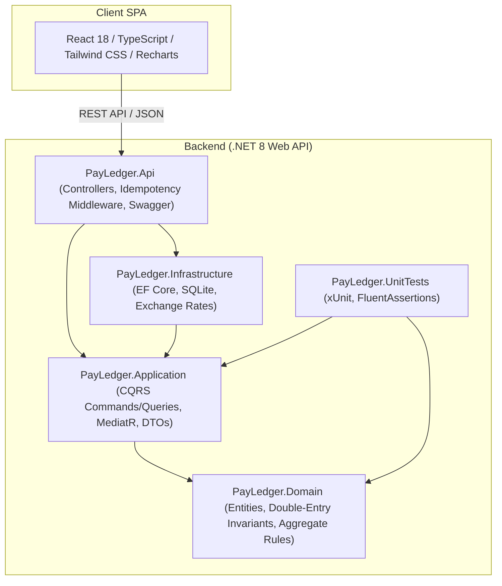

# PayLedger

Double-Entry Financial Ledger & Multi-Currency Settlement Engine, built with **.NET 8** and **React 18 / TypeScript**.

The application models core fintech banking and payment ledger workflows: immutable double-entry bookkeeping, atomic multi-legged transactions, cross-currency foreign exchange (FX) settlement pools, cryptographic idempotency key verification to prevent duplicate charges, and automated ledger balance reconciliation.

---

## Architecture Overview

The solution adheres to **Clean Architecture** and **CQRS (Command Query Responsibility Segregation)** principles using MediatR:



### Layer Responsibilities

* **`PayLedger.Domain`**: Encapsulated aggregate roots (`Account`, `LedgerTransaction`, `LedgerEntry`, `IdempotencyRecord`), strict double-entry zero-sum invariant enforcement ($\sum \text{Debits} == \sum \text{Credits}$), asset/liability normal balance transitions, and compensating reversal (Storno) mechanics.
* **`PayLedger.Application`**: CQRS command and query handlers using MediatR (`ExecuteTransferCommand`, `ExecuteDepositCommand`, `ExecuteWithdrawalCommand`, `ExecuteExchangeCommand`, `ReverseTransactionCommand`, `VerifyLedgerIntegrityQuery`), database contracts (`IPayLedgerDbContext`), and DTO mappings.
* **`PayLedger.Infrastructure`**: Persistence layer using Entity Framework Core and SQLite, optimistic concurrency tokens (`RowVersion`), exchange rate conversion service (`ExchangeRateService`), and realistic European enterprise seed data (`DbSeeder`).
* **`PayLedger.Api`**: HTTP entry points, centralized exception handling middleware mapping domain violations to RFC 7807 problem details, and state-mutating request idempotency middleware (`Idempotency-Key` header with `X-Cache-Lookup: HIT/MISS` headers).
* **`PayLedger.UnitTests`**: 17 unit tests verifying double-entry invariants, insufficient funds protection, currency mismatches, multi-currency clearing, Storno reversals, and idempotency TTL logic.
* **`frontend`**: React 18 single-page application designed with an industrial financial terminal aesthetic (Carbon & Emerald palette), offering live account management, double-entry journal inspection, and an interactive idempotency testing simulator.

---

## Key Financial Features

* **Double-Entry Bookkeeping**: Every transaction consists of balanced Debit and Credit legs. Violations trigger domain-level `UnbalancedLedgerException` prior to persistence.
* **Idempotency Engine**: Prevents double-spending and duplicate charges on network retries. Repeating a request with the same `Idempotency-Key` replays the cached 200 response without re-executing ledger operations.
* **Optimistic Concurrency**: `RowVersion` concurrency checks protect account balances against concurrent race conditions.
* **Immutable Audit Trail & Storno**: Historical ledger entries are append-only. Cancellations and error corrections are executed through formal Storno transactions that flip Debit and Credit legs while preserving complete audit history.
* **Multi-Currency Clearing**: Cross-border transactions (PLN, EUR, USD) clear through dedicated technical FX pools, keeping each currency leg independently balanced.
* **Ledger Integrity Reconciliation**: Real-time verification endpoint (`GET /api/ledger/integrity`) audits all historical journal entries against current account balances to detect anomalies.

---

## Getting Started

### Prerequisites
* [.NET 8 SDK](https://dotnet.microsoft.com/download/dotnet/8.0)
* [Node.js 20+](https://nodejs.org/)

### Local Development

1. **Clone repository:**
   ```bash
   git clone https://github.com/krystianostrovski-code/PayLedger.git
   cd PayLedger
   ```

2. **Run Backend (.NET 8):**
   ```bash
   cd backend
   dotnet restore PayLedger.slnx
   dotnet run --project src/PayLedger.Api
   ```
   * API runs on `http://localhost:5001`
   * Swagger documentation: `http://localhost:5001/swagger`
   * SQLite database seeds with sample treasury vaults, B2B client wallets, and journal entries on initial launch.

3. **Run Frontend (React + Vite):**
   ```bash
   cd frontend
   npm install
   npm run dev
   ```
   * Client runs on `http://localhost:5175`

---

## Docker

Run the entire fullstack solution using Docker Compose:

```bash
docker compose up --build
```

* Frontend UI: `http://localhost:3000`
* Backend API: `http://localhost:5001`

---

## Running Tests

```bash
cd backend
dotnet test PayLedger.slnx
```

Test suite coverage (17 tests) includes:
* Zero-sum balance invariants ($\sum \text{Debit} == \sum \text{Credit}$).
* Minimum entry count validation (transactions require at least two legs).
* Overdraft protection on client Asset accounts.
* Normal balance rules (Debit increases Assets; Credit increases Liabilities).
* Storno reversal creation and prevention of double-reversals.
* Atomic transfer execution and balance updates.
* Multi-currency FX pool conversion.
* Comprehensive ledger integrity verification.
* Idempotency cache expiration and replay detection.

---

## Seeded Accounts Overview

| Account Number | Account Name | Type | Currency | Initial Balance |
|---|---|---|---|---|
| `PL-AST-PLN-10001` | Main Treasury Vault (PLN) | Asset | PLN | 1,000,000.00 PLN |
| `PL-AST-EUR-10002` | Main Treasury Vault (EUR) | Asset | EUR | 250,000.00 EUR |
| `PL-AST-PLN-20101` | TechCorp Polska Sp. z o.o. | Asset | PLN | 131,660.00 PLN |
| `PL-AST-EUR-20102` | Apex Logistics GmbH | Asset | EUR | 40,000.00 EUR |
| `PL-AST-USD-20103` | CloudScale SaaS Inc. | Asset | USD | 75,000.00 USD |
| `PL-AST-PLN-20104` | Baltic Freight Sp. k. | Asset | PLN | 42,900.00 PLN |
| `PL-AST-PLN-20105` | Silesia Software House | Asset | PLN | 18,340.00 PLN |
| `SETTLEMENT-INBOUND-PLN` | Inbound Settlement Clearing (PLN) | Liability | PLN | 1,171,475.00 PLN |
| `SETTLEMENT-INBOUND-EUR` | Inbound Settlement Clearing (EUR) | Liability | EUR | 295,000.00 EUR |
| `REV-FEE-GATEWAY-PLN` | Gateway Fee Revenue (PLN) | Revenue | PLN | 0.00 PLN |

---

## License
MIT
